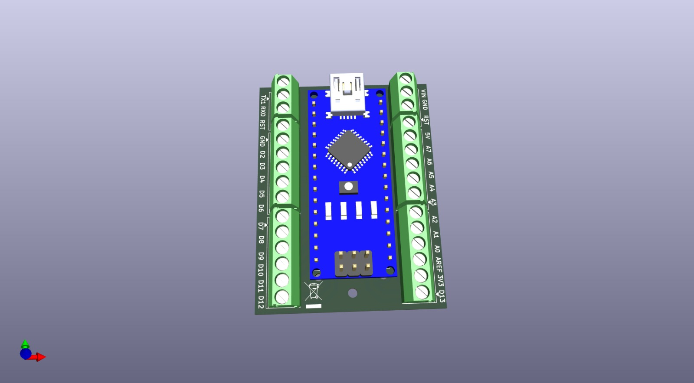
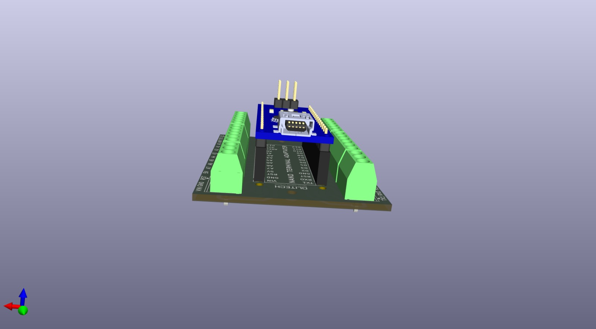
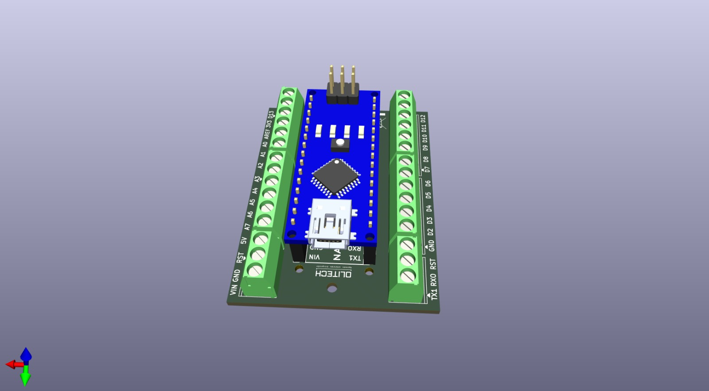

# Arduino Nano Terminal Adapter

**OLITECH · Conception d'une carte d'adaptation pour Arduino Nano**

*Conception d'une interface de raccordement pour Arduino Nano.*

---

**Marque / Brand:** OLITECH  
**Concepteur / Designer:** OLI OLI DONALD  
**Pays / Country:** Cameroun / Cameroon  
**Microcontrôleur:** Arduino Nano  
**Logiciel de conception:** KiCad EDA  

## Sommaire / Table of contents

- [🇫🇷 Français](#-français)
  - [Présentation](#présentation)
  - [Objectifs](#objectifs)
  - [Caractéristiques techniques](#caractéristiques-techniques)
  - [Travaux réalisés](#travaux-réalisés)
  - [Galerie du projet](#galerie-du-projet)
  - [État et limites du projet](#état-et-limites-du-projet)
  - [Documentation technique](#documentation-technique)
- [🇬🇧 English](#-english)
  - [Overview](#overview)
  - [Objectives](#objectives)
  - [Technical specifications](#technical-specifications)
  - [Work completed](#work-completed)
  - [Project gallery](#project-gallery)
  - [Project status and limitations](#project-status-and-limitations)
  - [Technical documentation](#technical-documentation)
- [Contact](#contact)

---

## 🇫🇷 Français

### Présentation

**Arduino Nano Terminal Adapter** est un projet de conception d'une carte électronique d'adaptation destinée à l'Arduino Nano.

Cette carte permet de faciliter l'accès aux différentes broches de l'Arduino Nano grâce à des borniers à vis, afin de simplifier le raccordement des signaux et des périphériques dans les montages électroniques.

Le schéma électronique et le circuit imprimé ont été conçus sous **KiCad EDA**.

### Objectifs

- Faciliter le raccordement des broches de l'Arduino Nano.
- Regrouper les connexions à travers des borniers à vis.
- Concevoir une interface pratique pour les montages électroniques.
- Vérifier la conformité du schéma et du PCB aux règles de conception.

### Caractéristiques techniques

| Paramètre | Description |
|---|---|
| Application | Carte d'adaptation pour Arduino Nano |
| Carte compatible | Arduino Nano |
| Connectique | Borniers à vis |
| Logiciel de conception | KiCad EDA |
| Conception électronique | Schéma électronique |
| Conception PCB | Réalisée |
| Vérification DRC | Réussie, aucune erreur |

### Travaux réalisés

- Conception du schéma électronique sous KiCad.
- Conception et routage du circuit imprimé.
- Vérification DRC du schéma électronique.
- Vérification DRC du PCB.
- Correction des erreurs détectées jusqu'à l'obtention de contrôles sans erreur.

### Galerie du projet

Les images suivantes présentent différentes vues du travail de conception de la carte d'adaptation.

| Vue de conception | Aperçu |
|---|---|
| Vue 1 |  |
| Vue 2 |  |
| Vue 3 |  |
| Vue 4 |  |
| Vue 5 |  |
| Vue 6 |  |

### État et limites du projet

| Élément | Statut |
|---|---|
| Schéma électronique | Réalisé |
| Conception PCB | Réalisée |
| Vérification DRC du schéma | Réussie, aucune erreur |
| Vérification DRC du PCB | Réussie, aucune erreur |
| Fabrication physique | Non réalisée |
| Assemblage | Non réalisé |
| Essais physiques | Non réalisés |

> **Remarque :** le projet est au stade de la conception numérique. Les contrôles DRC sans erreur confirment le respect des règles de conception vérifiées par KiCad, mais ne constituent pas une validation du fonctionnement d'un prototype physique.

### Documentation technique

Les documents techniques sont disponibles dans le répertoire [documents/](documents/).

- [Schéma électronique – Arduino Nano](documents/SCHEMATIC%20ADAPTER%20%20FOR%20NANO.pdf)
- [Côté composants – Arduino Nano](documents/COTE%20COMPOSANT%20ADAPTER%20%20FOR%20NANO.pdf)
- [Typon du circuit imprimé](documents/TYPON%20%20ADAPTER%20%20FOR%20NANO.pdf)

---

## 🇬🇧 English

### Overview

**Arduino Nano Terminal Adapter** is a PCB design project intended for the Arduino Nano.

The board provides easier access to the Arduino Nano pins through screw terminals, simplifying signal and peripheral connections in electronic applications.

The electronic schematic and PCB layout were designed using **KiCad EDA**.

### Objectives

- Make Arduino Nano pin connections easier.
- Group connections through screw terminals.
- Design a practical interface for electronic applications.
- Verify the schematic and PCB against design rules.

### Technical specifications

| Parameter | Description |
|---|---|
| Application | Arduino Nano terminal adapter |
| Compatible board | Arduino Nano |
| Connectivity | Screw terminals |
| Design software | KiCad EDA |
| Electronic design | Schematic |
| PCB design | Completed |
| DRC verification | Passed, no errors |

### Work completed

- Electronic schematic design using KiCad.
- PCB design and routing.
- Schematic DRC verification.
- PCB DRC verification.
- Correction of detected errors until both checks were error-free.

### Project gallery

The following images show different views of the adapter board design.

| Design view | Preview |
|---|---|
| View 1 |  |
| View 2 |  |
| View 3 |  |
| View 4 |  |
| View 5 |  |
| View 6 |  |

### Project status and limitations

| Item | Status |
|---|---|
| Electronic schematic | Completed |
| PCB design | Completed |
| Schematic DRC verification | Passed, no errors |
| PCB DRC verification | Passed, no errors |
| Physical fabrication | Not performed |
| Assembly | Not performed |
| Physical testing | Not performed |

> **Note:** this project is currently at the digital design stage. Error-free DRC checks confirm compliance with the design rules verified by KiCad, but do not validate the operation of a physical prototype.

### Technical documentation

Technical documents are available in the [documents/](documents/) directory.

- [Electronic schematic – Arduino Nano](documents/SCHEMATIC%20ADAPTER%20%20FOR%20NANO.pdf)
- [Component placement – Arduino Nano](documents/COTE%20COMPOSANT%20ADAPTER%20%20FOR%20NANO.pdf)
- [PCB artwork](documents/TYPON%20%20ADAPTER%20%20FOR%20NANO.pdf)

---

## Contact

**OLI OLI DONALD · OLITECH**  
Cameroon  
GitHub: [DONALDOLI1](https://github.com/DONALDOLI1)

*OLITECH — Electronic design and practical engineering.*
